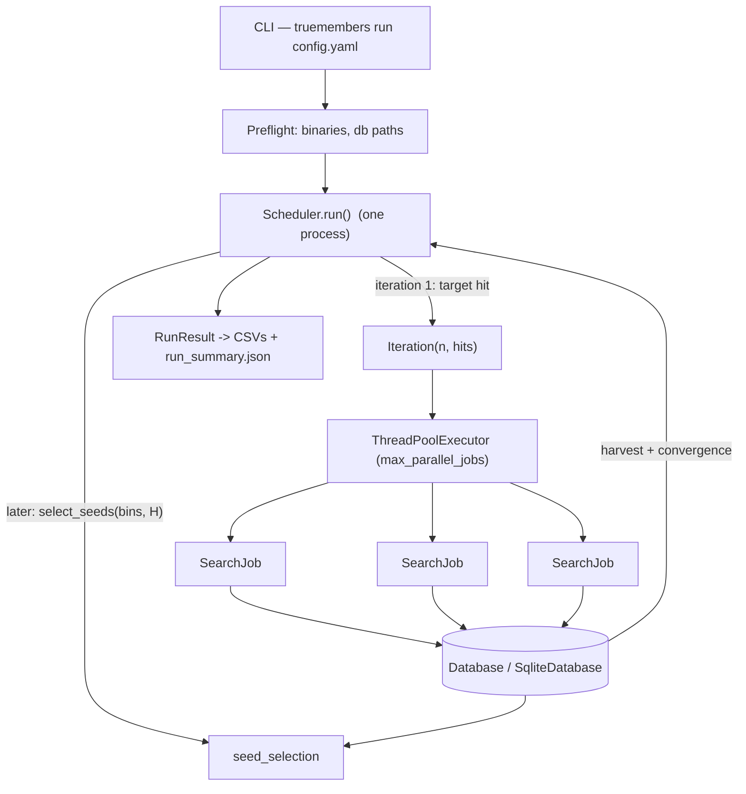
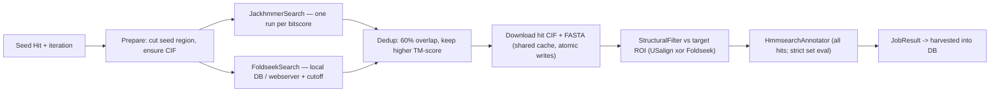

# TrueMembers v2 — Local-First Reimplementation Plan

## Goal

Reimplement TrueMembers on a clean base: no Slurm dependency, locally runnable end-to-end, testable without an HPC. Structure: CLI → Scheduler → Iteration → SearchJob, with a database interface, decoupled tool interfaces, and CSV/JSON result exports for the user.

## Context (verified)

- `main` (584fd5e) is the working product: Slurm-coupled (`sbatch`/`sacct`), per-job shell scripts, seed selection = highest qtmscore, strict membership = structural filter + all HMM domains.
- `dev`, `version_2`, `origin/dev` are the **same commit** (5491e25). `version_2` is the correct branch to evolve; `main` stays as legacy reference.
- evcouplings relative-bitscore semantics (`evcouplings/align/protocol.py:search_thresholds`): query = sequence **cut to the target region**; a float threshold is converted to an absolute HMMER threshold as `threshold × len(cut_query)`; ints are absolute. Each bitscore batch = a **separate jackhmmer run** with `-T`, `--domT`, `--incT`, `--incdomT` all set to that absolute value. We replicate this exactly.
- jackhmmer requires a local sequence FASTA database; there is no realistic internet-only sequence search. Foldseek can run against a local DB or the webserver.

## Locked decisions

| Topic | Decision |
|---|---|
| Terminology | "True members" is retired. Results are **`all_members`** (passed structural filter) and **`strict_members`** (all members + required HMM domains). Flags in code: `is_all_member`, `is_strict_member`. |
| Execution | Whole tool runs as one process (locally, or inside one Slurm job on HPC). No Executor interface. Within an iteration, SearchJobs run in a bounded `ThreadPoolExecutor`; DB and log-file writes happen on the main thread. |
| Sequence search | Bare `jackhmmer`. One run **per configured relative bitscore** (e.g. 0.2, 0.4, ...), replicating evcouplings: query = seed region-cut sequence, absolute `-T/--domT/--incT/--incdomT` = `bitscore × len(cut_query)`, `-N` iterations from config. |
| Structure search | Local Foldseek DB primary (`structure_db_path`), webserver as optional mode. User-settable cutoff `structure_search.tm_score_cutoff` applied to the search results. Fix old bug: webserver cutoff uses the TM-score field, not `eval`. |
| Structural filter | Exactly one tool: `usalign` **or** `foldseek` (no "both"). Always filters candidates against the **initial target ROI** with `structural_filter.tm_score_cutoff`. |
| Membership | Structural filter mandatory for `all_members`. hmmsearch annotation always runs when HMMs are configured; `require_domains` + `required_hmms` (empty = all folder HMMs) define `strict_members`. |
| Seed selection | Identity-binned B×H intent, naive implementation for now (see below). |
| Convergence | Relative `min_growth`, single-iteration trigger; also stop at `max_iterations` (non-convergence mode) or when no unused seeds remain. |
| Dedup | Same accession + region overlap ≥ **60% of the shorter interval** → same hit. Keep the hit with the **higher TM-score** (fallback: higher bitscore, then longer interval, then first seen) including its region and score; **drop the other** but union the detection provenance into the winner. Applied within a job and against existing DB hits. |
| Database | `Database` interface (ABC) + `SqliteDatabase`. Single `hits` table (`unique_id` UUID PK because one accession can be hit in several regions) + `seed_uses`, `iterations`, `sequence_identity`. Files stay on disk; DB stores paths. |
| Response | `RunResult` dataclass; exports `strict_members.csv`, `all_members.csv`, `search_jobs.csv`, `iterations.csv`, `run_summary.json`. |
| Tool decoupling | `Protocol` interfaces for search/filter/annotation tools; concrete adapters injected into SearchJob. |
| Package layout | Flat `truemembers/` package at repo root; salvage working utilities; delete half-finished orchestration. |
| Tests | Unit tests with fakes/in-memory SQLite + offline E2E with stub executables on PATH. |
| Extra scope | Dependency preflight (#9), docs rewrite + HMM how-to (#11), retire Slurm artifacts. |

## Target architecture



SearchJob flow:



## Object model and naming (consistent)

| Concept | Name |
|---|---|
| Deduplicated detected protein region | `Hit` (frozen dataclass; `unique_id`, `uniprot_id`, `region_start`, `region_end`) |
| Hit that passed the structural filter | `Hit.is_all_member = True` |
| All member that also contains the required domains | `Hit.is_strict_member = True` |
| One seed's search execution | `SearchJob` |
| Batch of SearchJobs | `Iteration` |
| Run orchestrator | `Scheduler` |
| Persistence | `Database` (ABC), `SqliteDatabase` |
| Tool interfaces | `SequenceSearchTool`, `StructureSearchTool`, `StructuralFilterTool`, `DomainAnnotationTool` (Protocol) |
| Tool adapters | `JackhmmerSearch`, `FoldseekSearch`, `FoldseekWebserverSearch`, `UsalignFilter`, `FoldseekFilter`, `HmmsearchAnnotator` |
| Data providers | `SequenceProvider` (local DB/API), `StructureProvider` (AlphaFold + cache), `SequenceIdentityProvider` (mmseqs2) |
| Result objects | `RunResult`, `IterationSummary`, `JobSummary`, `StopReason` |

There is **no `Seed` class**. A seed is a role: a `Hit` referenced by the `seed_uses` table and passed to `SearchJob(hit, iteration)`. This avoids a type that exists only to wrap the same data (composition/inheritance would both duplicate fields without adding behavior).

`Hit` fields: `unique_id`, `uniprot_id`, `region_start`, `region_end`, `detection_method` (`JACKHMMER` / `FOLDSEEK` / `JACKHMMER_AND_FOLDSEEK`), `bitscore` (best across bitscore runs), `tm_score_to_target`, `ali_coverage` (aligned length / query length, diagnostic), `domains: dict[str, tuple[int, int]]`, `is_all_member`, `is_strict_member`, `first_seen_iteration`, `structure_path`, `sequence_path`.

## Package layout

```
truemembers/
├── __init__.py
├── cli.py                     # argv, run dirs, preflight, wiring, summary print
├── config.py                  # dataclasses + load/validate YAML
├── models.py                  # Hit, DetectionMethod, JobResult, JobSummary, IterationSummary, StopReason, RunResult
├── db.py                      # Database ABC + SqliteDatabase (schema, merge, queries, exports)
├── environment.py             # preflight checks
├── scheduler.py               # iteration loop, stop conditions, RunResult assembly
├── iteration.py               # jobs in ThreadPoolExecutor, harvest, per-iteration log
├── search_job.py              # one seed's pipeline, tool protocols injected
├── seed_selection.py          # identity-binned selection (naive density-aware)
├── results.py                 # RunResult -> CSV/JSON exports
├── steps/
│   ├── sequence_search.py     # JackhmmerSearch
│   ├── structure_search.py    # FoldseekSearch + FoldseekWebserverSearch
│   ├── dedup.py               # 60% reciprocal-overlap merge
│   ├── structural_filter.py   # UsalignFilter + FoldseekFilter
│   └── domain_annotation.py   # HmmsearchAnnotator
└── services/
    ├── uniprot.py             # SequenceProvider: FASTA lookup/download/cache (salvaged)
    ├── structures.py          # StructureProvider: AlphaFold CIF + ROI extraction (salvaged)
    └── sequence_identity.py   # SequenceIdentityProvider: mmseqs2 (adapted)
tests/
├── unit/
└── e2e/{stubs,fixtures}/
```

`pyproject.toml`: entry point `truemembers = truemembers.cli:main`; packages `truemembers*`; pytest `testpaths=["tests"]`, `e2e` marker.

## Database schema

```sql
CREATE TABLE IF NOT EXISTS hits (
    unique_id TEXT PRIMARY KEY,            -- uuid; one accession may appear with several regions
    uniprot_id TEXT NOT NULL,
    region_start INTEGER NOT NULL,
    region_end INTEGER NOT NULL,
    detection_method TEXT NOT NULL,
    bitscore REAL,
    tm_score_to_target REAL,
    ali_coverage REAL,
    structure_path TEXT,
    sequence_path TEXT,
    structural_pass INTEGER NOT NULL DEFAULT 0,   -- rejected candidates are kept for diagnostics
    is_all_member INTEGER NOT NULL DEFAULT 0,
    is_strict_member INTEGER NOT NULL DEFAULT 0,
    first_seen_iteration INTEGER NOT NULL,
    domains TEXT NOT NULL DEFAULT '{}'     -- JSON {"hmm_name": [start, end]}
);
CREATE INDEX IF NOT EXISTS idx_hits_uniprot ON hits(uniprot_id);

CREATE TABLE IF NOT EXISTS seed_uses (
    unique_id TEXT PRIMARY KEY REFERENCES hits(unique_id),
    uniprot_id TEXT NOT NULL,
    iteration INTEGER NOT NULL,
    status TEXT NOT NULL,                  -- PENDING | RUNNING | COMPLETED | FAILED | DROPPED
    attempts INTEGER NOT NULL DEFAULT 0,
    new_strict_members INTEGER,
    failed INTEGER NOT NULL DEFAULT 0
);

CREATE TABLE IF NOT EXISTS iterations (
    iteration INTEGER PRIMARY KEY,
    seeds_submitted INTEGER NOT NULL,
    jobs_completed INTEGER NOT NULL,
    jobs_failed INTEGER NOT NULL,
    new_strict_members INTEGER NOT NULL,
    total_strict_members INTEGER NOT NULL,
    growth REAL,
    started_at TEXT,
    finished_at TEXT
);

CREATE TABLE IF NOT EXISTS sequence_identity (
    seed_id TEXT NOT NULL,                 -- hits.unique_id of a used seed
    hit_id TEXT NOT NULL,                  -- hits.unique_id of a candidate
    pident REAL NOT NULL,
    PRIMARY KEY (seed_id, hit_id)
);
```

`Database` ABC: `init_schema`, `merge_hits(hits, iteration)`, `set_seed_status`, `record_iteration`, `upsert_identity_pairs`, `unused_strict_candidates`, `used_seeds`, `iteration_summaries`, `all_members_df`, `strict_members_df`, `hit_summaries_df`. `SqliteDatabase(database=":memory:")` must work for tests. All writes on the main thread.

Merge rule: keep winner by higher `tm_score_to_target` (fallback bitscore, longer interval, earlier `first_seen_iteration`), union `detection_method`, union domains, keep winner's region and score, carry over `structural_pass`/membership ORs. Non-overlapping hits on the same accession remain separate rows.

## Config schema

```yaml
run:
  target_uid: Q5SK37
  target_region_start: 507
  target_region_end: 569
  output_dir: runs
  convergence_mode: true
  min_growth: 0.2
  max_iterations: 10          # used when convergence_mode is false
  bins: 5                     # B: identity bins for seed selection
  hits_per_iteration: 10      # H: total seeds chosen per iteration
  max_parallel_jobs: 4
  max_job_retries: 1
  cpu: 4

sequence_search:
  bit_scores: [0.2, 0.4, 0.6, 0.8]  # floats = relative (bits/residue × region length), ints = absolute
  iterations: 5                     # jackhmmer -N

structure_search:
  mode: local                       # local | webserver
  structure_db_path: /path/to/foldseek_db   # required when mode=local
  tm_score_cutoff: 0.5              # user-settable search cutoff
  max_hits: 1000

structural_filter:
  tool: usalign                     # usalign | foldseek
  tm_score_cutoff: 0.6

domains:
  hmms_folder_path: hmm_domain_filters
  require_domains: false
  required_hmms: []                 # HMM NAME values; empty + require_domains=true => all folder HMMs

data:
  sequence_db_path: /path/to/uniprot.fasta  # required; jackhmmer target DB
  sequence_db_index_dir: ""                 # optional; where to put/build .ssi index
  structures_dir: ""                        # optional pre-populated CIF dir (read-only fallback)
```

`config.py` validates keys, ranges, and path existence; `foldseek_db_path` required only for local mode; `sequence_db_path` always required.

## Component behavior

### CLI
`truemembers run <config.yaml>` (+ `--check-only`, `--version`). Creates `runs/<target>_<timestamp>/` with `data/pipeline.db`, `shared/structures`, `shared/sequences`, `iterations/`, `results/`, `pipeline.log`. Runs preflight (exit 2 with a missing-dependency list), wires components, runs, prints summary, exit 0/1.

HPC usage (documented): wrap the same command in one Slurm script (`sbatch --wrap="truemembers run config.yaml"` or a small script) — no per-job Slurm scripts.

### Preflight (`environment.py`)
`shutil.which` for `jackhmmer`, `foldseek`, `USalign`/`usalign`, `hmmsearch`, `hmmpress`; `mmseqs` only when more than one iteration can run. Validates `sequence_db_path`, `structure_db_path` (local mode), `hmms_folder_path`. Returns structured results; reused by tests.

### Scheduler
1. Prepare target: fetch target sequence + CIF, cut target ROI once into the run dir (`target_roi.cif`).
2. Iteration 1 with `[target hit]`.
3. Loop: create `Iteration` → run jobs → harvest → record summary.
4. Stop: no unused strict candidates → `SEEDS_EXHAUSTED`; convergence mode and growth < `min_growth` → `CONVERGED`; non-convergence and `n >= max_iterations` → `MAX_ITERATIONS`; all jobs failed with no progress → `FAILED`.
5. `select_seeds` for the next iteration.
6. Build `RunResult`, export files, log to `pipeline.log`.

Growth = `new_strict_members / max(1, total_strict_before)`, 0.0 when no new members.

### Iteration
Holds `iteration_number` and seed `Hit`s; builds one `SearchJob` per seed. Runs them through a `ThreadPoolExecutor(max_workers=max_parallel_jobs)` (returns `JobResult`s; exceptions captured per job). Retries failed jobs up to `max_job_retries` using a fresh attempt subdirectory. Harvests on the main thread: `db.merge_hits`, seed statuses, iteration row, then identity update for seed selection. Writes `iterations/iteration_<n>/iteration.log`.

### SearchJob
1. `SequenceProvider` cuts seed sequence to its region (header `>{uniprot_id}/{start}-{end}`) and ensures seed CIF is cached.
2. `SequenceSearchTool.search(...)`: one jackhmmer run per configured bitscore (see below) → hits.
3. `StructureSearchTool.search(...)`: foldseek local/webserver with `tm_score_cutoff` and `max_hits` → hits.
4. `dedup.merge_hits(...)` across all sources (60% overlap rule, union provenance).
5. `StructureProvider` downloads CIF + FASTA for unique accessions into `shared/` (atomic `.tmp` → rename, cache hits).
6. `StructuralFilterTool.filter(...)` vs target ROI: sets `tm_score_to_target`, `ali_coverage`, `structural_pass`; rejected hits stay in `JobResult` (persisted for diagnostics) but are not members.
7. `DomainAnnotationTool.annotate(...)` on structurally passed sequences (when HMMs configured): per-HMM regions; evaluate `required_hmms` → `is_strict_member`.
8. Writes per-job log + tool outputs to `iterations/iteration_<n>/seed_<uniprot_id>_<region>/`.

### JackhmmerSearch (critical detail)
For each relative bitscore `b` in config (floats): `abs = b × len(cut_query)`. Run, per bitscore, into its own subdir:

```
jackhmmer -N <iterations> --noali -A out.sto --tblout out.tbl --domtblout out.domtblout \
  -T <abs> --domT <abs> --incT <abs> --incdomT <abs> --cpu <cpu> cut_query.fa sequence_db.fasta
```

Parse `domtblout` (columns per HMMER spec): target accession (UniProt regex), `ali_from`/`ali_to` (region on target), full-sequence bitscore, domain bitscore/evalue. Hits from all bitscore runs are merged by region-aware dedup; `bitscore` = best observed. Ints in `bit_scores` are passed through as absolute (evcouplings-compatible). Document that `--incT/--incdomT` govern iteration inclusion and mirror evcouplings.

### FoldseekSearch
- Local: `foldseek easy-search <seed_roi.cif> <structure_db_path> hits.tsv tmp --format-output query,target,evalue,qtmscore,ttmscore`; keep `qtmscore ≥ structure_search.tm_score_cutoff`, cap `max_hits`.
- Webserver: existing submit/poll/parse flow (salvaged); apply the cutoff to the alignment TM-score field (`score`), **not** `eval` (fixes latent bug). Document rate-limit/reproducibility caveat.

### StructuralFilter
`usalign`: `USalign -dir1 <candidates_dir> target_list <target_roi.cif> -outfmt 2`; parse TM2 → `tm_score_to_target`.
`foldseek`: `foldseek easy-search <target_roi.cif> <candidates_dir> ...`; use `qtmscore`. Only one tool is active (config validated).

### DomainAnnotation
`hmmpress` concatenated HMMs, `hmmsearch` on the FASTA of structurally passed hits, parse with GA cutoffs (salvaged) → per-hit domain regions + per-HMM booleans. Strictness: if `require_domains`, required set = `required_hmms` or all folder HMMs; hit with all present → `is_strict_member`.

### Seed selection (naive, density-aware placeholder)
- Candidates: `is_strict_member = 1` not in `seed_uses` (if `require_domains` is off, strict == all).
- `SequenceIdentityProvider.max_identity_to_seeds(candidates, used_seeds)` via mmseqs2, cached incrementally in `sequence_identity`.
- Bin candidates into `bins` quantile bins of max-identity; sort bins by **population ascending**; draw round-robin from bins, within each bin by `tm_score_to_target` desc, until `hits_per_iteration` seeds are chosen (or candidates exhausted).
- Assumption to confirm: this implements "naive: take seeds from any bin until H total, favoring less dense bins". A density-weighted `SeedSelectionStrategy` can replace it later behind a small function.
- Deterministic, testable: empty pool, H > pool, all identity 0, all identity ~100, more bins than candidates.

### SequenceProvider / index guidance (answered questions)
- `sequence_db_path` is **required**: jackhmmer cannot search an API; evcouplings also needed a local UniProt FASTA. Users download UniProt FASTA once (or use a cluster-provided path).
- SSI index is **optional**: `esl-sfetch --index file.fasta` speeds random access; the tool builds it when the directory is writable, else uses `sequence_db_index_dir`. Unindexed FASTA works.
- The hand-rolled per-accession offset index (`uniprot_local.py`) is a legitimate pattern for fast hit-sequence retrieval without REST; keep it behind `SequenceProvider` with tests. `pyfaidx` is a possible later replacement.
- `structure_db_path` (Foldseek-formatted DB, e.g. AFDB50) is required only for local structure search; AlphaFold CIFs of hits are downloaded and cached per run (`structures_dir` can pre-seed them offline).
- Internet-only runs are not realistic for the sequence search; only structure search has a webserver mode.

### Shared caches
`shared/structures` and `shared/sequences` per run are intentional: parallel jobs dedupe downloads via atomic writes (`.tmp` → rename). Bulk files stay on disk; SQLite stores only paths (standard practice). A cross-run cache (`data.cache_dir`) is a possible later enhancement.

### Logging
`pipeline.log` (Scheduler), `iterations/iteration_<n>/iteration.log`, `iterations/iteration_<n>/seed_<uid>/job.log` (per job, via a dedicated named logger + FileHandler). Tool stdout/stderr and output files live in the job dir. Docstrings/comments use "strict members" terminology throughout.

### Exports (`results.py`)
- `all_members.csv`: hit info columns + `tm_score_to_target`, `bitscore`, `ali_coverage`, detection method, domain JSON + one `contains_<hmm>` boolean column per HMM, `first_seen_iteration`.
- `strict_members.csv`: same schema, strict subset.
- `search_jobs.csv`: iteration, job id, seed unique_id/accession/region, status, attempts, counts per stage (sequence hits, structure hits, deduped, downloads, structural pass, new strict), duration_s, error.
- `iterations.csv`: per-iteration summary (jobs, new/total strict, growth, duration).
- `run_summary.json`: target, stop reason, iteration + job summaries, counts, timings, config snapshot.
Replaces `create_run_summary.py`.

## Implementation tasks (ordered)

1. Branch + skeleton: branch `v2-reimplementation` from `version_2`; create `truemembers/` and `tests/`; update `pyproject.toml`.
2. `models.py` + `config.py` with validation + unit tests.
3. `db.py`: `Database` ABC + `SqliteDatabase`; merge/dedup (60% rule, winner = higher TM-score, drop loser, union provenance), queries, exports; tmp-SQLite and `:memory:` tests.
4. `environment.py` preflight (+ conditional mmseqs) with tests.
5. Salvage services: `uniprot.py`, `structures.py`, `sequence_identity.py`; port existing tests; identity provider API `max_identity_to_seeds`.
6. Tool protocols (`typing.Protocol`) in `steps/` and concrete adapters.
7. `steps/sequence_search.py`: multi-run JackhmmerSearch + domtblout parsing + relative→absolute threshold tests against a hand-computed fixture.
8. `steps/structure_search.py`: local + webserver modes + cutoff tests (canned TSV/JSON).
9. `steps/dedup.py`, `steps/structural_filter.py`, `steps/domain_annotation.py` + tests (overlap boundary 59.9/60.1%, winner selection, rejected hits kept).
10. `search_job.py`: orchestration with injected fake tools; happy path, empty search, all rejected, tool failure.
11. `iteration.py`: thread pool, retry, fresh attempt dirs, harvest; tests with fake tools controlling results.
12. `seed_selection.py`: binning + density-ascending round-robin; tests listed above.
13. `scheduler.py`: loop + stop reasons + RunResult; tests with fake jobs.
14. `results.py` + `cli.py`; CLI tests with monkeypatched preflight/scheduler.
15. Offline E2E: stub `jackhmmer`/`foldseek`/`USalign`/`hmmsearch` scripts in `tests/e2e/stubs/`; CLI E2E with `convergence_mode: false, max_iterations: 1` (no mmseqs needed); in-process multi-iteration E2E with fake identity provider; assert DB rows, exports, stop reasons, per-job logs.
16. Cleanup: delete `src/`, Slurm script/templates, `create_run_summary.py`, old config/tests; keep `hmm_domain_filters/` fixtures.
17. Docs: README (local quickstart, config reference, outputs, HPC = whole tool in one Slurm job), AGENTS.md rewrite, HMM how-to (Pfam/InterPro + GA requirement), `hpc_environment.yml` updated (drop evcouplings).

## Logic review — flaws and guardrails

1. **Target-anchored membership vs exploratory seeds**: divergent seeds will find proteins that fail the target-ROI cutoff and get discarded. That is a valid definition of the target's family, but report per-iteration rejection counts so exploration effectiveness is visible; the filter anchor can become configurable later.
2. **Short ROI TM-scores**: 63-residue query TM-scores are noisy. Record `ali_coverage`; consider a `min_alignment_coverage` option in a follow-up.
3. **Seed pool**: seeds come from strict members (all members when no domains are required), so junk hits never seed new searches.
4. **Same accession, new region**: sequence identity to used seeds is ~100% → densest bin; acceptable, but note it when tuning.
5. **Multiple bitscore runs multiply cost**: N separate jackhmmer runs per seed by design; dedup across runs; log per-run hit counts.
6. **Failed jobs mid-pipeline**: retries use a fresh attempt directory (no stale files, no partial harvest); partial-result harvesting is out of scope.
7. **Webserver cutoff bug fixed**: map cutoff to TM-score `score`, not `eval`.
8. **CPU oversubscription**: document `max_parallel_jobs × cpu`; default conservatively.
9. **Concurrency safety**: external tools in worker threads; DB/log writes only on the main thread.
10. **Rejected candidates persisted** (`structural_pass=0`) so diagnostics don't rely on logs alone.

## Validation

- `pytest tests/ -v` green (unit + `e2e`, offline, no Slurm).
- CLI E2E produces `data/pipeline.db`, all four result files, and prints a summary.
- Manual HPC smoke test before release (real binaries, small `max_iterations`) run as a single Slurm job.

## Deferred (out of scope)

- Slurm-specific job orchestration (whole-tool Slurm wrapping only), Executor abstraction, domain architecture visualization (#7), run resume, `min_alignment_coverage`, density-weighted or clustered seed selection, global cross-run cache.
