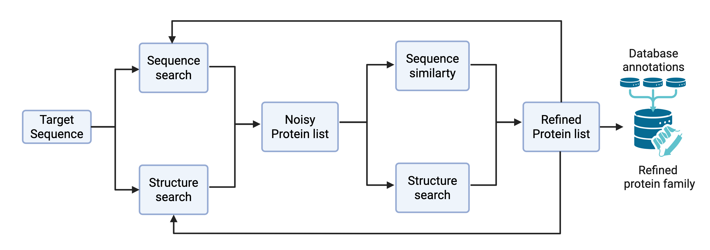

# TrueMembers

Automated pipeline for the identification and curation of homologous proteins within a protein family. Combines HMM-based sequence search (JackHMMER via evcouplings), structural similarity filtering (Foldseek + USalign), and HMM domain validation (hmmsearch) in an iterative workflow that converges when few or no new family members are discovered.

<p align="center">  </p>
<p align="center"><em>Figure 1. Flowchart illustrating key steps of the TrueMembers pipeline.</em></p>

## Prerequisites

| Tool                             | Purpose                     | Install method                                         |
| -------------------------------- | --------------------------- | ------------------------------------------------------ |
| evcouplings (includes jackhmmer) | Iterative sequence search   | HPC module (`module load evcouplings`)                 |
| Foldseek                         | Structural alignment        | Conda env (see below for MPCDF instructions) foldseek` |
| USalign                          | Pairwise TM-score alignment | Conda env (see below for MPCDF instructions) usalign`  |
| hmmer (hmmsearch, hmmpress)      | Domain detection            | Conda env (see below for MPCDF instructions) hmmer`    |
| Python ≥ 3.10 + dependencies     | Pipeline orchestration      | Conda env (see below for MPCDF instructions)           |

## Setup

## Getting the code

```bash
# clone the repository onto the HPC
git clone git@github.com:ElhabashyLab/TrueMembers.git
cd TrueMembers
```

### Local machine (development and testing)

This tool is not meant to be run on a local machine, but you can set up a local environment for development and testing.
The local environment only needs Python packages — external tools are mocked by the test suite.

```bash
# from the repo root
python3 -m venv .venv
source .venv/bin/activate
pip install -e ".[dev]"
```

Run tests:

```bash
cd True_Members
PYTHONPATH=. pytest tests/ -v
```

### HPC cluster (production on MPCDF Viper)

The cluster provides a `python-waterboa` module that includes a Conda-compatible Python. All other tools will be installed with creation of the `truemembers` conda environment. The `hpc_environment.yml` file lists all dependencies.

**Step 1 — Create a conda environment (one-time)**

```bash
# start from the repo root (where hpc_environment.yml lives)
module purge
module load python-waterboa/2024.06
eval "$(conda shell.bash hook)"

conda env create -f hpc_environment.yml
conda activate truemembers
pip install -e .
```

**Step 2 — Configure the run**

The configuration file `run_true_members_config.yaml` controls all parameters of the pipeline, including iteration settings, thresholds for sequence and structure filtering, and paths to necessary resources. Adjust these parameters based on your specific use case and computational resources.

Edit `run_true_members_config.yaml`:

```yaml
global:
  iterations: 3 # max iterations (non-convergence mode)
  max_parallel_jobs: 5 # concurrent Slurm jobs
  convergence_run: true # or false for fixed iterations
  absolute_floor: 5 # new members threshold for convergence
  patience_window: 5 # consecutive jobs below floor to stop

run:
  seed_uid: Q5SK37 # starting UniProt accession
  seed_region_start: 507
  seed_region_end: 569
  bit_scores: [0.2, 0.4, 0.6, 0.8] # JackHMMER bit score thresholds
  tm_score_cutoff: 0.6 # USalign TM-score threshold
  hmms_folder_path: hmm_domain_filters # local path to HMM profiles for domain validation
  CPU: 10
```

**Step 2 — Configure the hmm domain filters**

The `hmm_domain_filters` folder should contain HMM profiles for the domains you want to validate against. These profiles should contain a GA threshold.

**Step 4 — Run TrueMembers**

To run the pipeline, execute the Slurm submission script. This script initializes the scheduler that spawns individual jobs (one per iteration/seed). Results accumulate in `runs/run_<seed>_<timestamp>/`.

```bash
sbatch submit_run_true_memberes.sh
```

### 3. Monitor progress

```bash
squeue -u $USER                         # check running jobs
tail -f runs/<run_dir>/pipeline.log     # scheduler log
tail -f runs/<run_dir>/runs/<job_dir>/job.log  # per-job log
```

### 4. Output

| File                     | Location                                 | Contents                              |
| ------------------------ | ---------------------------------------- | ------------------------------------- |
| `seeds.csv`              | `runs/<run>/data/`                       | All true members found (seed pool)    |
| `All_Members_global.csv` | `runs/<run>/data/`                       | All sequences passing both filters    |
| `used_seeds.csv`         | `runs/<run>/data/`                       | Seeds processed + new members per job |
| Final results            | `runs/<run>/final_true_members_results/` | Snapshot copies at pipeline end       |

## Authors

Aron Wichtner, Hadeer Elhabashy

## Contact

Elhabashylab [@] gmail.com

## License

MIT. ⭐ If this tool helped your research, please consider starring the repository.
